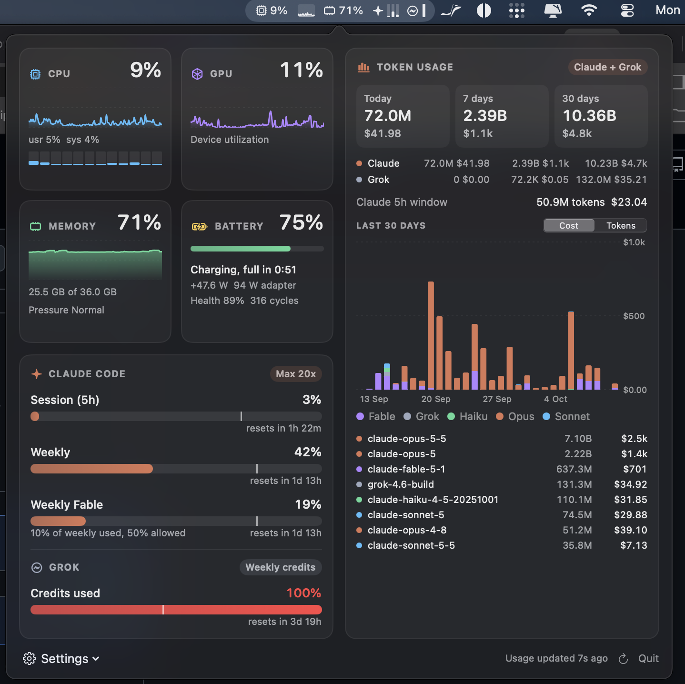

# Headroom

<a href="https://buymeacoffee.com/sandrich"></a>

A tiny macOS menu bar app that shows how much headroom you have left: on your machine (CPU, GPU, memory, battery) and on your AI coding plans (Claude Code and Grok).

One compact, native-looking item in the menu bar. Click it for a dashboard with live graphs; hover an item to see what is using it.

<p align="center"></p>

## Features

**Menu bar**
- One line, monochrome, tinted by macOS like every other menu bar item
- CPU and GPU with live sparklines, memory, battery
- Claude Code limits as three slim gauges (5h session, weekly, per-model weekly such as Fable)
- Grok credits gauge
- Each item can be switched on or off; sampling every 0.5 to 5 seconds

**Hover**
- CPU, GPU, memory, battery: top apps (helper processes are grouped under their app)
- Claude, Grok: exact limit percentages and reset times

**Dashboard**
- Live charts for CPU (with per-core bars), GPU and memory; battery state, power draw, health and cycles
- Claude Code plan limits with reset countdowns and a pace marker (where you would be if usage were spread evenly)
- Grok weekly credits
- Combined token usage for Claude Code and Grok: today, last 7 days, last 30 days, tokens and cost, a 30-day chart by model family, and a per-model table, similar to [ccusage](https://github.com/ryoppippi/ccusage)

Providers you do not use are hidden automatically.

## Requirements

- macOS 14 or newer (built and tested on Apple Silicon)
- Xcode command line tools (Swift 5.9+)
- Optional: [Claude Code](https://claude.com/claude-code) signed in with a Claude subscription
- Optional: the [Grok CLI](https://x.ai/cli) signed in (`grok login`)

## Build and install

```bash
./build.sh            # builds build/Headroom.app
./build.sh install    # copies it to /Applications and launches it
```

Headroom registers itself as a login item on first launch. Turn that off under Settings in the dashboard footer.

## How it works

Everything is sampled locally and cheaply. Steady-state cost is around 1% of one core with the dashboard closed.

| Data | Source |
| --- | --- |
| CPU | `host_processor_info` tick deltas |
| Memory | `host_statistics64` (app + wired + compressed, like Activity Monitor), memory pressure via `sysctl` |
| GPU | IOKit `IOAccelerator` `PerformanceStatistics` |
| Battery | IOKit power sources and `AppleSmartBattery` |
| Top apps | `libproc` (`proc_pid_rusage`) and per-client GPU time from the GPU driver's IORegistry entries; only sampled while a hover panel is open |
| Claude Code limits | The usage endpoint Claude Code itself uses, authenticated with Claude Code's OAuth token from the login keychain (read via `/usr/bin/security`; never stored, logged or refreshed by Headroom) |
| Claude Code tokens | `~/.claude/projects/**/*.jsonl`, tailed incrementally by byte offset and cached in `~/Library/Application Support/Headroom` |
| Grok credits | The billing endpoint the Grok CLI's `/usage` uses, with the CLI's token from `~/.grok/auth.json`. If that token has expired, Headroom runs `grok models` once so the CLI refreshes it; Headroom never writes the file. |
| Grok tokens | `~/.grok/sessions/*/*/usage.json` |
| Prices | [LiteLLM's model price list](https://github.com/BerriAI/litellm), refreshed daily |

### Accuracy notes

- Token totals follow ccusage's rules: deduplicated by message id and request id, keeping the final counts of messages that were logged several times while streaming, and including advisor sub-calls. Days are local calendar days; "7 days" and "30 days" include today.
- Cost can differ slightly from ccusage because Headroom prices 1-hour cache writes at their own (higher) rate.
- Grok cost comes from the CLI's own per-turn cost figures.
- Energy in the battery hover panel is shown as each app's share of energy used, because the kernel counters do not have a documented unit.
- Root-owned processes (for example `WindowServer` CPU or `kernel_task`) cannot be read without elevated rights and are missing from the CPU, memory and energy lists.

### Caveats

The Claude and Grok usage endpoints are not public APIs. They may change without notice, in which case those sections show the last known values and an error until Headroom is updated.

## Development

```bash
swift build                                     # debug build
.build/release/Headroom --snapshot /tmp/shots   # renders the menu bar strip and dashboard to PNGs, then exits
```

Source layout (`Sources/Headroom`):

- `main.swift`: app delegate, timers, status item, popover
- `SystemSampler.swift`: CPU, GPU, memory, battery
- `Consumers.swift`: per-app top consumers for the hover panels
- `Clients.swift`: Claude Code and Grok plan limits
- `Ledger.swift`: token ledger, pricing, summaries
- `StatusRenderer.swift`: draws the menu bar strip
- `PopoverView.swift`, `Hover.swift`: SwiftUI dashboard and hover panels

## Support

If Headroom saves you a trip to Activity Monitor or a surprise rate limit, you can [buy me a coffee](https://buymeacoffee.com/sandrich).

## License

MIT, see [LICENSE](LICENSE).
